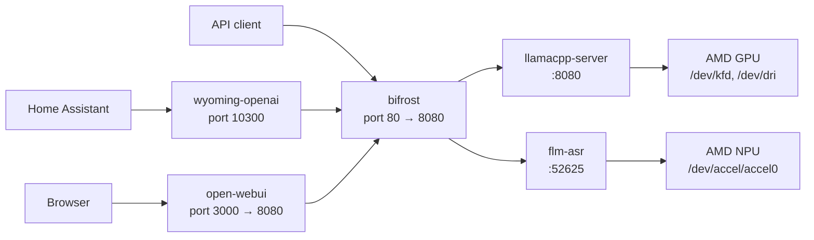

# LLM Stack

A local LLM inference server for AMD Strix Halo (Ryzen AI Max, `gfx1151`), deployed via Ansible on **Ubuntu 26.04 x86_64**. Other distributions, releases, and architectures are not supported.

The playbook runs five rootless Podman Quadlet user services:

- `llamacpp-server`: llama.cpp `llama-server` built on the target with ROCm 10.0 for `gfx1151`, on the GPU
- `flm-asr`: [FastFlowLM](https://github.com/ROCm/FastFlowLM) Whisper-V3-Turbo speech-to-text on the XDNA 2 NPU
- `bifrost`: [Bifrost](https://github.com/maximhq/bifrost) gateway, the single OpenAI-compatible endpoint for both
- `wyoming-openai`: [Wyoming](https://github.com/roryeckel/wyoming_openai) bridge so Home Assistant can use the speech-to-text
- `open-webui`: [Open WebUI](https://github.com/open-webui/open-webui) chat front end that talks to Bifrost

ROCm and XRT are only in the images. The host needs the kernel drivers and firmware, the TTM memory limit, Podman, and unlimited locked memory for the service account (the `stt` role sets it).

## Quick Start

```bash
# install the toolchain and deploy to the target host
./setup.sh

# install the toolchain only
./setup.sh --dev
```

The setup script prompts for:
- **Target Endpoint** — hostname or IP of the target machine (default: `host.example.com`)
- **Target User** — SSH user for remote targets (default: `ubuntu`). For `localhost`, the playbook uses a local connection.

Remote targets log in with the SSH password (press Enter at the prompt to use an SSH key instead). Password login needs `sshpass` on the machine running Ansible (`sudo apt install sshpass`). A new host key is accepted on first connect; a changed key is rejected.

The first run builds two images before the services start: llama-server (20–40 minutes) and FastFlowLM (a few minutes).

### First Boot

The TTM limit is set in the initramfs, so **reboot after the first run**. The playbook prints a notice when the limit changes. To check the limit:

```bash
cat /sys/module/ttm/parameters/pages_limit   # equals common_ttm_pages_limit
```

## Service

| Service | Port | Description |
|---------|------|-------------|
| SSH | 22 | Remote access |
| Bifrost | 80 | OpenAI-compatible API (`/v1`) + Bifrost dashboard (`/`) |
| Wyoming bridge | 10300 | Speech-to-text for Home Assistant |
| Open WebUI | 3000 | Chat in the browser, through Bifrost |
| llama-server | 127.0.0.1:8080 | Backend; API and built-in Web UI on the host only |
| flm-asr | 127.0.0.1:52625 | Backend; speech-to-text on the host only |

The API is at `http://<target>/v1`. Model IDs carry the Bifrost provider name: `llamacpp/<preset>` for chat (for example `llamacpp/unsloth/gpt-oss-20b-GGUF:F16`) and `flm/whisper-v3` for `/v1/audio/transcriptions`. To list them, run `curl http://<target>/v1/models`. The `flm/` list includes every FastFlowLM model, but only `flm/whisper-v3` is loaded.

```bash
curl http://<target>/v1/audio/transcriptions -F file=@clip.wav -F model=flm/whisper-v3 -F language=en
```

Set `language` when you know it: without it Whisper detects the language and can add made-up text at trailing silence.

Long audio is limited by upload size first: Bifrost accepts at most 100 MB per request, about 9 minutes of 44.1 kHz stereo WAV. Compressed formats (ogg, mp3) go much further. A transcription must finish within `router_stt_timeout` (300 s), and that includes time spent waiting behind another request, so a long file also delays Home Assistant commands.

At most `inference_models_max` models are loaded at once (default `1`). A request for another model unloads the least recently used idle model. The API has no key, so use it only on a trusted network.

The Bifrost dashboard at `http://<target>/` shows request logs. Log in as `admin` with the password in `credentials/bifrost-admin` on the machine that ran the playbook (generated on the first run, gitignored).

### Open WebUI

Open the chat at `http://<target>:3000`. It has no login: everyone on the network shares one user and its chat history, kept in the volume `open-webui-data`. Turning login on later requires deleting that volume. Its chats go through Bifrost, so they appear in the Bifrost logs. The connection to Bifrost is stored in its database on first start; change it later under Admin Settings → Connections.

### Home Assistant

Add the **Wyoming Protocol** integration with host `<target>` and port `10300`, then select `flm/whisper-v3` as the speech-to-text engine of an Assist pipeline. A short command takes about 2 s to transcribe: Whisper always processes a 30 s window. Requests are handled one at a time.

To test the bridge from a workstation:

```bash
uv run --no-project --with wyoming python -I tests/wyoming_roundtrip.py <target> 10300 clip.wav
```

## Managing the Service

The services are systemd user services of the account `service_account_user` (`llm` by default). The account has no password or SSH key. Lingering starts its user manager at boot without a login, and the user manager sets `XDG_RUNTIME_DIR` for the service. You do not need to set it in `.bashrc`.

From the admin account:

```bash
sudo systemctl --user -M llm@ status llamacpp-server.service
sudo systemctl --user -M llm@ restart llamacpp-server.service
sudo journalctl --user -M llm@ -u llamacpp-server.service -f
```

For a shell as `llm`, for example to run `podman`, open a login session:

```bash
sudo machinectl shell llm@
podman images localhost/llama-server
```

`sudo -u llm` and `su - llm` do not open a login session. `XDG_RUNTIME_DIR` is then not set, and `systemctl --user` and `podman` cannot find the user manager or the container state.

## Architecture



All containers join the Quadlet network `llm.network` and reach each other by container name. Named volumes hold the downloads and state: `llamacpp-models`, `flm-models`, `bifrost-data` (Bifrost's `config.db` and `logs.db`), and `open-webui-data` (users and chats). Bifrost reads `~llm/.config/bifrost/config.json` at every start, and the file wins over changes made in the dashboard (`source_of_truth: config.json`).

### llama-server

1. `roles/inference/files/Containerfile` has two stages. The builder stage compiles llama.cpp at `inference_llama_ref` for `gfx1151` with ROCm's clang. The runtime stage contains only the ROCm runtime and the llama.cpp binaries.
2. The image tag is `localhost/llama-server:<llama_ref>-rocm10.0`. The playbook builds the image when the tag does not exist or when the Containerfile changed. A rebuild replaces the existing tag.
3. The playbook checks that the container can use the GPU (`llama-server --list-devices` must list `ROCm0`), deploys the Quadlet, and waits until `/health` returns 200.

## Upgrading and Rolling Back llama.cpp

**Upgrade:** set `inference_llama_ref` in `roles/inference/defaults/main.yml` to a new [llama.cpp release tag](https://github.com/ggml-org/llama.cpp/releases), then:

```bash
uv run ansible-playbook -i <host>, playbook.yml --tags inference -u <user> --ask-pass --ask-become-pass
# or, without editing the file:
uv run ansible-playbook -i <host>, playbook.yml --tags inference -u <user> --ask-pass --ask-become-pass -e inference_llama_ref=<tag>
```

A new tag builds a new image and restarts the service. Older images stay on the host.

**Roll back:** set `inference_llama_ref` to the previous tag and run the playbook again. The old image is still on the host, so no build runs, unless the Containerfile changed since that image was built.

**Disk:** each build leaves an untagged builder image that contains the ROCm toolchain (several GB). In `sudo machinectl shell llm@`, remove it with `podman image prune -f`, and remove old tags with `podman image rm localhost/llama-server:<tag>`.

## Upgrading FastFlowLM

Set `stt_flm_version` in `roles/stt/defaults/main.yml` to a [FastFlowLM release](https://github.com/ROCm/FastFlowLM/releases) that ships an `ubuntu26.04` package, then run the playbook with `--tags stt`. The play builds a new image, checks that the container sees the NPU, and transcribes a test clip.

The NPU needs the IOMMU (the `common` role fails if `amd_iommu=off` is set), the `render` group for `/dev/accel/accel0`, and unlimited locked memory. A rootless container cannot raise that limit above its account's, so the `stt` role writes `/etc/security/limits.d/90-<service_account_user>-memlock.conf` and restarts the account's user manager (`user@<uid>.service`) when that file changes. That restart stops and restarts every service of the account, so in-flight chat and speech requests fail and `machinectl shell` sessions end. It happens on the first run, or after the file is changed. The container runs with an init process because `flm` ignores SIGTERM as PID 1.

FastFlowLM's NPU kernels are closed source, free to use and redistribute under the FastFlowLM NPU Binary License. Powered by [FastFlowLM](https://github.com/ROCm/FastFlowLM).

## Kernel and Firmware Upgrades

The containers bring their own ROCm and XRT user space, which must match the host's `amdgpu`/`amdxdna` drivers and firmware. The `common` role therefore holds `linux-firmware` and the installed kernel metapackage from `common_held_packages` (`linux-generic`, `linux-generic-hwe-26.04` or `linux-oem-26.04`), and unattended upgrades leave them alone. The role fails if none of these kernel metapackages is installed. To upgrade them:

```bash
apt-mark showhold
sudo apt-mark unhold linux-generic linux-firmware   # the packages listed by showhold
sudo apt full-upgrade
sudo reboot
# then re-run the playbook: it re-applies the hold and checks the GPU and NPU from the containers
```

`nvtop` shows GPU load and memory. `xrt-smi examine` shows the NPU and its firmware version.

## Roles Reference

| Role | Tags | Purpose |
|------|------|---------|
| `common` | `common` | IOMMU check, packages, kernel and firmware hold, tuned profile, journald limits, TTM pages limit and initramfs rebuild (no ROCm on the host), unattended security upgrades, base firewall |
| `service_account` | (dependency) | Service account (`render`/`video`, lingering), `llm.network`. Runs with each of the roles below |
| `inference` | `inference` | llama-server image build, GPU check, preset file, Quadlet, health check |
| `stt` | `stt` | Memlock limit for the service account (restarts its user manager when changed), FastFlowLM image build, NPU check, Quadlet, transcription check |
| `router` | `router` | Bifrost config and Quadlet, Wyoming bridge and Open WebUI Quadlets, unprivileged port, firewall, end-to-end checks. Needs `inference` and `stt` deployed first |

## Configuration

### Model Presets

The playbook generates the server's preset `.ini` file from `inference_presets` in `roles/inference/defaults/main.yml`. Each key is an `.ini` section: `"*"` applies to all models, every other key is one model:

```yaml
inference_presets:
  "*":
    n-gpu-layers: 999
    load-mode: none
  "organization/model-GGUF:UD-Q8_K_XL":
    c: 131072
    hf-repo: organization/model-GGUF:UD-Q8_K_XL
    load-on-startup: true # optional: load at startup (use on one preset at most)
    temp: 1.0
```

Keys are llama.cpp CLI arguments without leading dashes (see the [model presets documentation](https://github.com/ggml-org/llama.cpp/blob/master/tools/server/README.md#model-presets)). YAML booleans are written as `true`/`false`. The server does not start if a key is unknown. Check the log with `sudo journalctl --user -M llm@ -u llamacpp-server.service`.

### Prompt Cache

`cache-ram: 8192` in the `"*"` preset gives llama.cpp 8 GiB of host RAM to keep processed prompt prefixes. A request that starts with the same text as an earlier one (system prompt, earlier turns of a chat) skips processing that part again.

### Key Variables

| Variable | Default | Description |
|----------|---------|-------------|
| `inference_llama_ref` | `v0.5.0` | llama.cpp git tag built into the image |
| `inference_models_max` | `1` | Models loaded at once |
| `stt_flm_version` | `1.0.10` | FastFlowLM release built into the image |
| `router_port` | `80` | Host port for Bifrost |
| `router_wyoming_port` | `10300` | Host port for the Wyoming bridge |
| `router_bifrost_image` | `docker.io/maximhq/bifrost:v2.3.2` | Bifrost image |
| `router_wyoming_image` | `ghcr.io/roryeckel/wyoming_openai:0.8.0` | Wyoming bridge image |
| `router_webui_port` | `3000` | Host port for Open WebUI |
| `router_webui_image` | `ghcr.io/open-webui/open-webui:v0.12.3` | Open WebUI image |
| `router_stt_timeout` | `300` | Seconds Bifrost waits for a transcription |
| `router_chat_timeout` | `900` | Seconds Bifrost waits for a non-streaming chat or completion |
| `service_account_user` | `llm` | Account that owns and runs the services |
| `common_held_packages` | `linux-firmware`, kernel metapackages | Packages held against upgrades, if installed |
| `common_ttm_pages_limit` | `26214400` | TTM pages limit (GPU-addressable system memory) |
| `common_tuned_profile` | `throughput-performance` | `tuned` profile |
| `common_unattended_reboot` | `false` | Allow unattended reboots at 03:00 |

## Local Validation

After `./setup.sh --dev`:

```bash
./validate.sh
```

This runs an Ansible syntax check and `ansible-lint` with the production profile. To test the image build without deploying:

```bash
podman build --build-arg LLAMA_REF=v0.5.0 -t localhost/llama-server:v0.5.0-rocm10.0 roles/inference/files
```

The playbook does not reuse an image built this way: it rebuilds it, because the image lacks the Containerfile hash label that the playbook checks.
