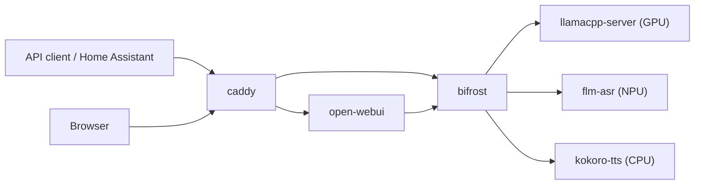

# LLM Stack

A local LLM inference server for AMD Strix Halo (Ryzen AI Max, `gfx1151`), deployed via Ansible on **Ubuntu 26.04 x86_64**. Other distributions, releases, and architectures are not supported.

Each service role runs one rootless Podman Quadlet user service. Every role except `service_account` has a tag of the same name. Settings and pinned versions are in each role's `defaults/main.yml`.

| Role | Container | Hardware | Purpose |
|------|-----------|----------|---------|
| `common` | | | Host setup: packages, kernel and firmware hold, GPU memory (TTM) limit, firewall, unattended upgrades, … |
| `service_account` | | | The service account (lingering, memlock limit) and `llm.network`; a dependency of every service role |
| `inference` | `llamacpp-server:8080` | GPU | llama.cpp `llama-server`, built on the target with ROCm |
| `stt` | `flm-asr:52625` | NPU | [FastFlowLM](https://github.com/ROCm/FastFlowLM) Whisper speech-to-text |
| `tts` | `kokoro-tts:3000` | CPU | [Kokoros](https://github.com/lucasjinreal/Kokoros) text-to-speech, built on the target |
| `router` | `bifrost:8080` | | [Bifrost](https://github.com/maximhq/bifrost), the single OpenAI-compatible endpoint for the three backends |
| `webui` | `open-webui:8080` | | [Open WebUI](https://github.com/open-webui/open-webui) chat front end, through Bifrost |
| `proxy` | `caddy:80` | | [Caddy](https://caddyserver.com), the only published port, routes by hostname to Bifrost and Open WebUI |

Roles run in the order above (`playbook.yml`): `router` needs the three backends, and `proxy` needs `router` and `webui`.



## Quick Start

```bash
./setup.sh         # install the toolchain and deploy; prompts for the target host and SSH user
./setup.sh --dev   # install the toolchain only
```

Remote targets log in with the SSH password, or press Enter to use an SSH key. Password login needs `sshpass` on the machine running Ansible.

The first run builds three images: llama-server (20–40 minutes), Kokoros (about 10 minutes) and FastFlowLM (a few minutes). **Reboot after the first run**: the TTM memory limit only applies from the initramfs, and the playbook prints a notice whenever it changes.

## Documentation

- [Usage](docs/usage.md): API, Open WebUI, Home Assistant
- [Operations](docs/operations.md): managing services, changing models, upgrades

## Development

```bash
./setup.sh --dev
./validate.sh   # syntax check and ansible-lint
```

FastFlowLM's NPU kernels are closed source, free to use and redistribute under the FastFlowLM NPU Binary License. Powered by [FastFlowLM](https://github.com/ROCm/FastFlowLM).
